# Design System

## Overview

This document describes the design tokens used to style LORIS and the conventions
for using them. The tokens are defined in [`htdocs/css/tokens.css`](../htdocs/css/tokens.css),
which is loaded on every page. For language conventions, see
[CodingStandards.md](CodingStandards.md).

## Tokens

Colours, spacing and border radii should come from `tokens.css` rather than being
hardcoded. If no existing token fits, a new one should be added to `tokens.css`.

```css
/* Avoid */
.thing { background: #eaf1f8; border-radius: 4px; padding: 8px; }

/* Prefer */
.thing {
    background: var(--accent-fill);
    border-radius: var(--radius);
    padding: var(--space-md);
}
```

Tokens are named for what they are used for (`--accent`, `--border`, `--text-muted`)
rather than for their value, so changing a token's value restyles everything that
uses it.

A suffix on a colour token indicates which shade of the colour it uses:

| Suffix | Shade | Used for |
|---|---|---|
| none | The base colour | Borders, icons, filled buttons, text |
| `-strong` | Darker | Pressed buttons |
| `-fill` | Light tint | Backgrounds such as a selected row or a tag |
| `-highlight` | Very light tint | Hover |

## Colours

The header of `htdocs/bootstrap/css/custom-css.css` lists a "Loris color palette
v.0.1" with two blues and an orange, but only as a comment, so no code can reference
it. The colours below start from those values and add the shades needed by the
interface. A colour that is not in these tables should be added here and to
`tokens.css` before it is used.

### Blue (accent)

| | Token | Hex | Used for |
|---|---|---|---|
|  | `--accent-strong` | `#042d54` | Pressed |
|  | `--accent` | `#064785` | Navigation, panel headings |
|  | `--accent-border`, `--info-edge` | `#246eb6` | Borders, the focus ring, the outline of an info-coloured control |
| 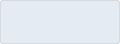 | `--accent-fill` | `#e4ebf2` | Selected row |
| 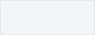 | `--accent-highlight` | `#f3f6f9` | Hovered row |

### Light blue (info)

| | Token | Hex | Used for |
|---|---|---|---|
|  | `--info` | `#a6d3f5` | Help text, notices, a toggle that is on |
| 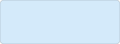 | `--info-fill` | `#d4eafa` | Background for help text and notices |

### Orange (secondary)

Orange marks an in-progress state, such as the rows a drag is currently selecting.

| | Token | Hex | Used for |
|---|---|---|---|
|  | `--secondary`, `--warning` | `#e89a0c` | Active border, warnings |
| 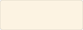 | `--secondary-fill` | `#fcf3e2` | Active background |

### Success and danger

| | Token | Hex | Used for |
|---|---|---|---|
|  | `--success` | `#0f9d58` | Success |
|  | `--danger-strong` | `#963221` | Pressed danger button |
|  | `--danger` | `#c0402a` | Errors, danger buttons |

### Grey

| | Token | Hex | Used for |
|---|---|---|---|
| 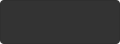 | `--text` | `#333333` | Text |
| 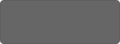 | `--text-muted`, `--control-off-edge` | `#666666` | Muted text, the outline of a toggle that is off |
| 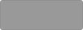 | `--text-faint`, `--control-off` | `#999999` | Faint text, a toggle that is off |
| 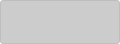 | `--border`, `--text-disabled` | `#cccccc` | Borders, dividers, disabled text |
| 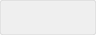 | `--border-subtle` | `#efefef` | Subtle borders |
| 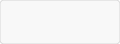 | `--surface-sunken` | `#f8f8f8` | Recessed backgrounds |
| 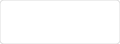 | `--surface` | `#ffffff` | Backgrounds |

## States

| State | Tokens | Meaning |
|---|---|---|
| Hover | `--state-hover` | The pointer is over the element |
| Selected | `--state-selected`, `--state-selected-solid` | The element has been chosen, e.g. a checked option in a dropdown |
| Active | `--state-active`, `--state-active-solid` | The element is in a temporary state that changes when the action finishes, e.g. rows a drag is passing over |

Buttons do not have a selected state. On hover, a button's border and label change
colour and its background stays the same.

## Accessibility

- Colour should never be the only way a state is shown. A selected or active row
  should also have a bar on its left edge, a checkbox should show a tick, and a
  toggle should move its handle.
- Two states should differ in lightness, not only in hue, so they can be told apart
  by someone who cannot distinguish the colours.
- Light colours (`--info`, `--secondary`) should not be used for text. Text should
  use the text tokens, placed on a `-fill` background where a colour is needed.
- A control drawn in a light colour should have an outline so it is visible against
  a white page (`--info-edge`, `--control-off-edge`). Use an `inset` box-shadow for
  the outline so the control does not change size when its state changes.

If a token's value does not meet these rules, the value should be changed in
`tokens.css` so the fix applies everywhere.

## Fonts

| Token | Font | Used for |
|---|---|---|
| `--font-family` | The operating system's default interface font | All text |
| `--font-family-mono` | The operating system's default monospace font | Identifiers |

The monospace font should be used for values someone might copy or type out:
PSCIDs, DCCIDs, visit labels, barcodes, file names and paths. It should not be used
for field names, counts or sentences.

## Where styles go

| What | Where |
|---|---|
| Values shared by more than one component | `htdocs/css/tokens.css` |
| A component's own styling | A CSS file next to the component, imported by it |
| A module's own layout | `modules/<module>/css/`, imported by the module's JSX |
| Anything with a `:hover`, `:focus` or `:disabled` state | A CSS file, not an inline style |

Inline styles cannot express states or media queries, so they should only be used
for values calculated at runtime.

## Bootstrap

LORIS uses Bootstrap 3, which stopped receiving security updates in 2019. Removing it
would affect every module, so it remains for now, but new components should not
depend on it and should take their styling from the tokens instead.

Reusing a Bootstrap class with a different layout leads to specificity conflicts.
For example, `.form-control` sets `display: block`, `.input-group` sets
`display: table` and `.list-group-item.active` sets `z-index: 2`, and each can
override a rule of equal specificity depending on load order. Qualify the selector with
the element (e.g. `button.my-trigger`) instead of using `!important`.
