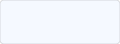
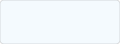
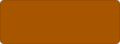
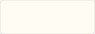
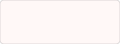
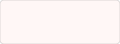
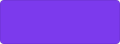
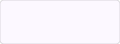
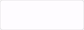
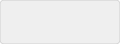

# Design System

## Overview

This document describes the design tokens used to style LORIS and the conventions
for using them. The tokens are defined in [`htdocs/css/tokens.css`](../htdocs/css/tokens.css),
which is loaded on every page. For language conventions, see
[CodingStandards.md](CodingStandards.md).

## Tokens

Colours, spacing and border radii should come from `tokens.css` rather than being
hardcoded. If no existing token fits, a new one should be added to `tokens.css`.

```css
/* Avoid */
.thing { background: #eaf1f8; border-radius: 4px; padding: 8px; }

/* Prefer */
.thing {
    background: var(--primary-fill);
    border-radius: var(--radius);
    padding: var(--space-md);
}
```

Tokens are named for what they are used for (`--primary`, `--border`, `--text-muted`)
rather than for their value, so changing a token's value restyles everything that
uses it.

Every colour has the same five shades, named by suffix:

| Suffix | Shade | Used for | Contrast |
|---|---|---|---|
| none | The base colour | Navigation, icons, filled buttons | Varies, see below |
| `-strong` | Darkest | Pressed states, text in that colour, a filled button with white text when the base is too light | At least 4.5:1 against white and against the colour's `-fill` |
| `-border` | Mid | Borders, outlines and chart marks | At least 3:1 against white and against the colour's `-fill` |
| `-fill` | Light tint | Backgrounds such as a tag or a notice | `--text` on it is at least 4.5:1 |
| `-highlight` | Very light tint | Hover | `--text` on it is at least 4.5:1 |

Chart marks should use the `-border` shade or darker.

## Colours

The navy and the orange come from the "Loris color palette v.0.1" in the header of
`htdocs/bootstrap/css/custom-css.css`. Every colour's other four shades come from
its base by one rule, worked out in OKLCH at the base's hue: `-strong` is the
lightest shade that reaches 5:1 against white and against its `-fill`, `-border` is
the lightest that reaches 3.3:1, and `-fill` and `-highlight` are faint tints at one
lightness for every colour, kept light so text on them stays easy to read. Orange's
darker shades lean towards red and its tints towards yellow, since orange turns
muddy at its own hue, and light blue's shades lean towards cyan so they stay clear
of navy's.

A colour that is not in these tables should be added here and to `tokens.css`
before it is used, with every pairing checked against the rules under
Accessibility.

### Blue (primary)

Used for actions, navigation and panel headings.

| | Token | Hex | Used for |
|---|---|---|---|
|  | `--primary` | `#064785` | Navigation, panel headings, filled buttons |
|  | `--primary-strong` | `#01376b` | Pressed buttons, text in blue |
|  | `--primary-border` | `#528cd0` | Borders, the focus ring, chart marks |
|  | `--primary-fill` | `#f7faff` | Tags and notices |
|  | `--primary-highlight` | `#fbfdff` | Hover on a tag or notice |

### Light blue (info)

Used for help text, notices and a toggle that is on.

| | Token | Hex | Used for |
|---|---|---|---|
|  | `--info` | `#a6d3f5` | A toggle that is on |
|  | `--info-strong` | `#047693` | Text in light blue, filled buttons |
|  | `--info-border` | `#0496ba` | Borders, the outline of a toggle that is on, chart marks |
|  | `--info-fill` | `#f4fcff` | Background for help text and notices |
|  | `--info-highlight` | `#fafdff` | Hover |

### Orange (secondary)

Used for an in-progress state, such as the rows a drag is currently selecting, and for warnings.

| | Token | Hex | Used for |
|---|---|---|---|
|  | `--secondary`, `--warning` | `#e89a0c` | Warnings |
|  | `--secondary-strong`, `--warning-strong` | `#a85500` | Text in orange, filled buttons |
|  | `--secondary-border`, `--warning-border`, `--state-active-solid` | `#c97401` | The edge of an active row, chart marks |
|  | `--secondary-fill`, `--warning-fill` | `#fffae9` | Warnings and notices |
|  | `--secondary-highlight`, `--warning-highlight` | `#fffdf5` | Hover |

### Green (success)

| | Token | Hex | Used for |
|---|---|---|---|
|  | `--success` | `#059669` | Success icons |
|  | `--success-strong` | `#037b55` | Text in green, filled buttons |
|  | `--success-border` | `#1a9d70` | Borders, chart marks |
|  | `--success-fill` | `#eefff6` | Success background |
|  | `--success-highlight` | `#f8fffb` | Hover |

### Red (danger)

| | Token | Hex | Used for |
|---|---|---|---|
|  | `--danger` | `#cc1e1e` | Errors, danger buttons |
|  | `--danger-strong` | `#a92420` | Pressed danger button, text in red |
|  | `--danger-border` | `#ec5449` | Borders, chart marks |
|  | `--danger-fill` | `#fff8f7` | Error background |
|  | `--danger-highlight` | `#fffcfc` | Hover |

### Purple (category)

Purple has no fixed meaning, so it is used to tell categories apart where the other colours already carry one.

| | Token | Hex | Used for |
|---|---|---|---|
|  | `--category` | `#9137bb` | Categories, filled buttons |
|  | `--category-strong` | `#79329b` | Pressed, text in purple |
|  | `--category-border` | `#b665e0` | Borders, chart marks |
|  | `--category-fill` | `#fcf8ff` | Category background |
|  | `--category-highlight` | `#fefcff` | Hover |

### Grey

The greys are one scale, from text down to surfaces.

| | Token | Hex | Used for |
|---|---|---|---|
|  | `--text` | `#333333` | Text |
|  | `--text-muted`, `--control-off-edge` | `#666666` | Muted text, the outline of a toggle that is off |
|  | `--text-faint` | `#717171` | Faint text |
|  | `--border-strong`, `--field-border`, `--control-off` | `#8f8f8f` | Field borders, a toggle that is off |
|  | `--border`, `--text-disabled` | `#cccccc` | Dividers, disabled text |
|  | `--border-subtle` | `#efefef` | Subtle dividers |
|  | `--surface-sunken` | `#f8f8f8` | Recessed backgrounds |
|  | `--surface` | `#ffffff` | Backgrounds |

## States

| State | Tokens | Meaning |
|---|---|---|
| Hover | `--state-hover` | The pointer is over the element |
| Selected | `--state-selected`, `--state-selected-solid` | The element has been chosen, e.g. a checked option in a dropdown |
| Active | `--state-active`, `--state-active-solid` | The element is in a temporary state that changes when the action finishes, e.g. rows a drag is passing over |

The state tokens are their own tints, stronger than the `-fill` shades, so a hovered,
selected or active row shows against white.

Buttons do not have a selected state. On hover, a button's border and label change
colour and its background stays the same.

## Accessibility

Every pairing in this document meets [WCAG 2.2](https://www.w3.org/TR/WCAG22/) level AA:
4.5:1 for text and 3:1 for borders, icons and chart marks. New tokens should meet it
too. Disabled text (`--text-disabled`) is the one exception, as WCAG allows for
inactive controls. A disabled control should say why it is disabled on hover, using
`aria-disabled` rather than `disabled`, which blocks hover in some browsers.

- Colour should never be the only way a state is shown. A selected or active row
  should also have a bar on its left edge, a checkbox should show a tick, and a
  toggle should move its handle.
- Two states should differ in lightness, not only in hue, so they can be told apart
  by someone who cannot distinguish the colours.
- Text in a colour should use its `-strong` shade. The light blue, orange and green
  bases are too light for text, and too light for white text on top of them, so a
  filled button in one of those colours should use `-strong` as its background.
- `--text-faint` meets 4.5:1 on `--surface` and `--surface-sunken` only. On a
  coloured `-fill`, use `--text` or `--text-muted`.
- A field or control should have a border that meets 3:1 against white
  (`--field-border`, a `-border` shade). `--border` and `--border-subtle` are for
  dividers, which do not need to.
- A control drawn in a light colour should have an outline so it is visible against
  a white page (`--info-border`, `--control-off-edge`). Use an `inset` box-shadow for
  the outline so the control does not change size when its state changes.

If a token's value does not meet these rules, the value should be changed in
`tokens.css` so the fix applies everywhere.

## Fonts

| Token | Font | Used for |
|---|---|---|
| `--font-family` | The operating system's default interface font | All text |
| `--font-family-mono` | The operating system's default monospace font | Identifiers |

The monospace font should be used for values someone might copy or type out:
PSCIDs, DCCIDs, visit labels, barcodes, file names and paths. It should not be used
for field names, counts or sentences.

## Where styles go

| What | Where |
|---|---|
| Values shared by more than one component | `htdocs/css/tokens.css` |
| A component's own styling | A CSS file next to the component, imported by it |
| A module's own layout | `modules/<module>/css/`, imported by the module's JSX |
| Anything with a `:hover`, `:focus` or `:disabled` state | A CSS file, not an inline style |

Inline styles cannot express states or media queries, so they should only be used
for values calculated at runtime.

## Bootstrap

LORIS uses Bootstrap 3, which stopped receiving security updates in 2019. Removing it
would affect every module, so it remains for now, but new components should not
depend on it and should take their styling from the tokens instead.

Reusing a Bootstrap class with a different layout leads to specificity conflicts.
For example, `.form-control` sets `display: block`, `.input-group` sets
`display: table` and `.list-group-item.active` sets `z-index: 2`, and each can
override a rule of equal specificity depending on load order. Qualify the selector with
the element (e.g. `button.my-trigger`) instead of using `!important`.
