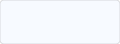
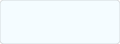
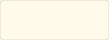
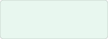

# Design System

## Overview

This document describes the design tokens used to style LORIS and the conventions
for using them. The tokens are defined in [`htdocs/css/tokens.css`](../htdocs/css/tokens.css),
which is loaded on every page. For language conventions, see
[CodingStandards.md](CodingStandards.md).

## Tokens

Colours, spacing and border radii should come from `tokens.css` rather than being
hardcoded. If no existing token fits, a new one should be added to `tokens.css`.

```css
/* Avoid */
.thing { background: #eaf1f8; border-radius: 4px; padding: 8px; }

/* Prefer */
.thing {
    background: var(--primary-fill);
    border-radius: var(--radius);
    padding: var(--space-md);
}
```

Tokens are named for what they are used for (`--primary`, `--border`, `--text-muted`)
rather than for their value, so changing a token's value restyles everything that
uses it.

Every colour has the same five shades, named by suffix:

| Suffix | Shade | Used for | Contrast |
|---|---|---|---|
| none | The base colour | Navigation, icons, filled buttons | Varies, see below |
| `-strong` | Darkest | Pressed states, text in that colour, a filled button with white text when the base is too light | At least 4.5:1 against white and against the colour's `-fill` |
| `-border` | Mid | Borders, outlines and chart marks | At least 3:1 against white and against the colour's `-fill` |
| `-fill` | Light tint | Backgrounds such as a tag or a notice | `--text` on it is at least 4.5:1 |
| `-highlight` | Very light tint | Hover | `--text` on it is at least 4.5:1 |

Chart marks should use the `-border` shade or darker.

## Colours

The navy and the orange come from the "Loris color palette v.0.1" in the header of
`htdocs/bootstrap/css/custom-css.css`. Every colour's other four shades come from
its base by one rule, worked out in OKLCH at the base's hue: `-strong` is the
lightest shade that reaches 5:1 against white and against its `-fill`, `-border` is
the lightest that reaches 3.3:1, and `-fill` and `-highlight` are faint tints at one
lightness for every colour, kept light so text on them stays easy to read. Orange's
darker shades lean towards red and its tints towards yellow, since orange turns
muddy at its own hue, and light blue's shades lean towards cyan so they stay clear
of navy's.

A colour that is not in these tables should be added here and to `tokens.css`
before it is used, with every pairing checked against the rules under
Accessibility.

### Blue (primary)

Used for actions, navigation and panel headings.

| | Token | Hex | Used for |
|---|---|---|---|
|  | `--primary` | `#064785` | Navigation, panel headings, filled buttons |
|  | `--primary-strong` | `#01376b` | Pressed buttons, text in blue |
|  | `--primary-border` | `#528cd0` | Borders, the focus ring, chart marks |
|  | `--primary-fill` | `#f7faff` | Tags and notices |
|  | `--primary-highlight` | `#fbfdff` | Hover on a tag or notice |

### Light blue (info)

Used for help text, notices and a toggle that is on.

| | Token | Hex | Used for |
|---|---|---|---|
|  | `--info` | `#a6d3f5` | A toggle that is on |
|  | `--info-strong` | `#047693` | Text in light blue, filled buttons |
|  | `--info-border` | `#0496ba` | Borders, the outline of a toggle that is on, chart marks |
|  | `--info-fill` | `#f4fcff` | Background for help text and notices |
|  | `--info-highlight` | `#fafdff` | Hover |

### Orange (secondary)

Used for an in-progress state, such as the rows a drag is currently selecting, and for warnings.

| | Token | Hex | Used for |
|---|---|---|---|
|  | `--secondary`, `--warning` | `#e89a0c` | Warnings |
|  | `--secondary-strong`, `--warning-strong` | `#a85500` | Text in orange, filled buttons |
|  | `--secondary-border`, `--warning-border`, `--state-active-solid` | `#c97401` | The edge of an active row, chart marks |
|  | `--secondary-fill`, `--warning-fill` | `#fffae9` | Warnings and notices |
|  | `--secondary-highlight`, `--warning-highlight` | `#fffdf5` | Hover |

### Green (success)

| | Token | Hex | Used for |
|---|---|---|---|
|  | `--success` | `#059669` | Success icons |
|  | `--success-strong` | `#037b55` | Text in green, filled buttons |
|  | `--success-border` | `#1a9d70` | Borders, chart marks |
|  | `--success-fill` | `#eefff6` | Success background |
|  | `--success-highlight` | `#f8fffb` | Hover |

### Red (danger)

| | Token | Hex | Used for |
|---|---|---|---|
|  | `--danger` | `#cc1e1e` | Errors, danger buttons |
|  | `--danger-strong` | `#a92420` | Pressed danger button, text in red |
|  | `--danger-border` | `#ec5449` | Borders, chart marks |
|  | `--danger-fill` | `#fff8f7` | Error background |
|  | `--danger-highlight` | `#fffcfc` | Hover |

### Purple (category)

Purple has no fixed meaning, so it is used to tell categories apart where the other colours already carry one.

| | Token | Hex | Used for |
|---|---|---|---|
|  | `--category` | `#9137bb` | Categories, filled buttons |
|  | `--category-strong` | `#79329b` | Pressed, text in purple |
|  | `--category-border` | `#b665e0` | Borders, chart marks |
|  | `--category-fill` | `#fcf8ff` | Category background |
|  | `--category-highlight` | `#fefcff` | Hover |

### Grey

The greys are one scale, from text down to surfaces.

| | Token | Hex | Used for |
|---|---|---|---|
|  | `--text` | `#333333` | Text |
|  | `--text-muted`, `--control-off-edge` | `#666666` | Muted text, the outline of a toggle that is off |
|  | `--text-faint` | `#717171` | Faint text |
|  | `--border-strong`, `--field-border`, `--control-off` | `#8f8f8f` | Field borders, a toggle that is off |
|  | `--border`, `--text-disabled` | `#cccccc` | Dividers, disabled text |
|  | `--border-subtle` | `#efefef` | Subtle dividers |
|  | `--surface-sunken` | `#f8f8f8` | Recessed backgrounds |
|  | `--surface` | `#ffffff` | Backgrounds |

## States

| State | Tokens | Meaning |
|---|---|---|
| Hover | `--state-hover` | The pointer is over the element |
| Selected | `--state-selected`, `--state-selected-solid` | The element has been chosen, e.g. a checked option in a dropdown |
| Active | `--state-active`, `--state-active-solid` | The element is in a temporary state that changes when the action finishes, e.g. rows a drag is passing over |

The state tokens are their own tints, stronger than the `-fill` shades, so a hovered,
selected or active row shows against white.

In a table, a row whose checkbox is ticked is selected, in blue. The row open in the
record panel takes the palest navy (`--primary-fill`) with a navy bar on its left edge.
A row that is both keeps the selected blue, and the bar shows it is open. Orange stays
for warnings and for temporary states such as the rows a drag passes over.

Buttons do not have a selected state. On hover, a primary or secondary button's border
and label change colour. A quiet button, drawn as text, takes `--state-hover` behind
its label; an underline marks a link, not an action.

## Elevation

| Token | Used for |
|---|---|
| `--shadow-raised` | A small control lifted off its surface, such as a row's menu |
| `--shadow-overlay` | A floating panel, such as a dropdown or a dialog |
| `--shadow-side` | A panel that slides over the rows from the right, casting its shadow to the left only |

The data sits on the bottom layer. Headers, footers and toolbars that stay in place
above it are flat, divided from it by a border rather than a shadow, so the data never
sits under a heavy edge. Only what lies over the data casts a shadow, and only onto
the data.

## Page chrome

The navbar is the darker navy, `--primary-strong`, so a filled primary button
stands apart from the bar above it. A hovered or open menu item turns white and
joins the menu that opens below it.

| Token | Draws from | Used for |
|---|---|---|
| `--chrome-bg` | `--primary-strong` | The navbar's background |
| `--chrome-text` | `--surface` | Its links and icons |
| `--chrome-hover` | `--surface` | A hovered or open menu item |
| `--chrome-hover-text` | `--primary-strong` | That item's text |

## Motion

| Token | Value | Used for |
|---|---|---|
| `--duration-fast` | 120ms | A small change in place: a caret turning, a label rising, a toggle's handle |
| `--duration-base` | 200ms | A short move or a small change of size: a column's width |
| `--duration-slow` | 300ms | A move across much of the screen: the filters, a side panel |
| `--ease` | `cubic-bezier(.4, 0, .2, 1)` | Every animation: it eases in and out, so nothing starts or stops abruptly |

Everything moves on the one curve, and the duration follows the distance: the further
something travels, the longer it takes. A change in size or position animates, so the
eye can follow what moved: a column eases to its new width, the filters grow from the
edge and push the rows aside, and a side panel slides in and back out from its edge.
Opening and closing move the same way. Colour and text changes do not animate, apart
from a field's label as it rises. Under `prefers-reduced-motion: reduce` every
transition and animation is turned off, and changes happen at once.

## Accessibility

Every pairing in this document meets [WCAG 2.2](https://www.w3.org/TR/WCAG22/) level AA:
4.5:1 for text and 3:1 for borders, icons and chart marks. New tokens should meet it
too. Disabled text (`--text-disabled`) is the one exception, as WCAG allows for
inactive controls. A disabled control should say why it is disabled on hover, using
`aria-disabled` rather than `disabled`, which blocks hover in some browsers.

- Colour should never be the only way a state is shown. A selected or active row
  should also have a bar on its left edge, a checkbox should show a tick, and a
  toggle should move its handle.
- Two states should differ in lightness, not only in hue, so they can be told apart
  by someone who cannot distinguish the colours.
- Text in a colour should use its `-strong` shade. The light blue, orange and green
  bases are too light for text, and too light for white text on top of them, so a
  filled button in one of those colours should use `-strong` as its background.
- `--text-faint` meets 4.5:1 on `--surface` and `--surface-sunken` only. On a
  coloured `-fill`, use `--text` or `--text-muted`.
- A field or control should have a border that meets 3:1 against white
  (`--field-border`, a `-border` shade). `--border` and `--border-subtle` are for
  dividers, which do not need to.
- A control drawn in a light colour should have an outline so it is visible against
  a white page (`--info-border`, `--control-off-edge`). Use an `inset` box-shadow for
  the outline so the control does not change size when its state changes.

If a token's value does not meet these rules, the value should be changed in
`tokens.css` so the fix applies everywhere.

## Components

New React components take their colours, spacing and states from the tokens and
live at the top of `jsx/`, so any module can use them.

### Icon

`jsx/Icon.tsx` draws an icon from [Lucide](https://lucide.dev) by name, as tall as
the text around it and in its colour: `<Icon name="search" />`. The icon is hidden
from assistive technology, so the control it sits in needs its own label: visible
text, or an `aria-label` with a Tooltip. New icons are added to its list of names.
Font Awesome remains for the page templates.

### Tag

`jsx/Tag.tsx` labels a value from a fixed set, such as a status or a category:
`<Tag tone="success">Closed</Tag>`. Each tone uses its colour's `-fill`, `-border`
and `-strong` shades: `neutral` (the default), `primary`, `info`, `success`,
`warning` and `danger`. The label always says what the colour means.

A value is a tag when it is an option from a short, fixed set that the reader scans a
column for: a status, a category, a flag. A value that names another record, such as a
site, a project or a cohort, shows its name after a small icon of its kind, and several
in one cell are set apart by a space. Identifiers, dates, numbers and free text are
plain text. A value shows the same way in a table and in its filter.

A tag takes a colour when its value is a state someone acts on: `success` for a good or
finished state, `warning` for one that needs attention, `danger` for a problem, `info`
for a state worth noticing. A category with no state is a neutral tag. When a category
has two or three values worth telling apart at a glance, such as entity type, each takes
`primary` or `info`, never a state colour. Sex stays neutral, since a colour per sex
reads as a stereotype.

A yes-or-no value shows as a check for yes and stays empty for no.

In a RecordTable, a column shows its values as tags with `tag: true`, or with a map
from value to tone, such as `tag: {'1': 'danger', '3': 'success'}`, where a value the
map leaves out is neutral. A column of linked records names its kind's icon with
`relation`, such as `relation: 'place'`. A row shows the tags or names that fit, with a
count for the rest; the record panel shows them all.

A cell that opens a page is one link across the cell, outlined with an arrow on hover:
`link: (value, record) => url`. A value links only when it has a page to open.

### Tooltip

`jsx/Tooltip.tsx` names or explains the element it wraps, on hover and on keyboard
focus. Icon-only buttons use it for their name, and table cells use it to show a value
their column cuts short.

### Field list

`jsx/FieldList.tsx` shows label and value pairs, one pair per row, as on a
record's card or in the record panel. Labels are in `--text-muted` and values in
`--text`.

```tsx
import FieldList from 'jsx/FieldList';

<FieldList
  size="sm"
  fields={[
    {name: 'site', label: t('Site'), value: site},
    {name: 'cohort', label: t('Cohort'), value: <Tag>{cohort}</Tag>},
  ]}
/>
```

| Prop | Values | Effect |
|---|---|---|
| `fields` | `{name, label, value, wide}[]` | The rows, in order; `name` is the React key, and `wide` gives a pair the full width in the `grid` layout |
| `layout` | `inline` (default), `inline-end`, `stacked`, `grid` | `inline` puts labels in one column and values in the next; `inline-end` aligns those labels against their values; `stacked` puts each label above its value; `grid` sets label-above-value pairs in as many columns of at least 150px as fit |
| `size` | `md` (default), `sm` | `sm` sets `--font-size-sm` and tighter rows, for cards |

In the inline layouts, the label column fits the longest label, up to 40% of the list's width. Lists
that sit side by side, such as a grid of cards, set `--field-list-label-width`
on a shared ancestor (the cards use `10em`), so every value starts at the same
offset in every list.

Every row is at least a tag's height, so a row of text and a row of tags are the
same height. Long values and several tags wrap inside the value column, and the
label stays on the value's first line. An empty value (`null`, `undefined`,
`false`, `''` or `[]`) shows a dash; `0` is a value and shows as `0`.

`FieldSections`, from the same file, sets several field lists under headings, each
one folding away from its heading. A section without a `label` has no heading and
stays open. A folded section stays folded from one record to the next.

```tsx
import {FieldSections} from 'jsx/FieldList';

<FieldSections
  sections={[
    {name: 'participant', label: t('Participant'), fields: participantFields},
    {name: 'visits', label: t('Visits'), fields: visitFields, collapsed: true},
  ]}
/>
```

Lists that follow one another, as in sections, share their label column through
`--field-list-label-width` (the record panel uses `min(40%, 12em)`), so values
start on the same line all the way down.

### Record panel

Clicking a row in a RecordTable opens its record in a panel on the right. The
panel's head holds the record's name, its actions and the controls that move
between records and close the panel. The first action is a secondary button
beside the name and any others are in the ⋯ menu next to it, as Ant Design's
Descriptions puts its actions at the top right of its title and Salesforce and
Jira put a record's actions on its name's line.

A table says how its records read with `recordLayout`, naming its columns:

```js
recordLayout={{
  title: 'pscid',
  key: ['dccid', 'participantStatus', {name: 'site', wide: true}],
  sections: [
    {label: t('Participant'), fields: ['sex', 'DoB', 'project']},
    {label: t('Visits'), fields: ['visitLabel', 'visitCount'], collapsed: true},
  ],
}}
```

| Key | Effect |
|---|---|
| `title` | The column whose value names the record in the panel's head; the first column otherwise |
| `key` | The fields that matter most, in a band under the head; `{name, wide: true}` gives one the band's full width |
| `sections` | Groups of fields under headings that fold, in order |

The key fields read as the record's summary, as in Salesforce's highlights panel:
label-above-value pairs, two to a row, on `--surface-sunken` between two faint
rules. A field with long values, such as a site's name or a list of tags, is marked
wide and takes a row to itself, so the band keeps the same shape from one record to
the next. The sections below set
one label and value a row, with labels in one column all the way down.

Every column the layout leaves out follows in a last section, More fields, in
column order, so a new column always shows somewhere. A table without a
`recordLayout` shows every column after the title in column order, with no
headings. Hidden columns show in the panel too.

### Select menus

A dropdown is as wide as its options need, at least 180px and never narrower than its
field. Its options run edge to edge, each highlighted with a square fill; the chosen
option takes `--state-selected` with the selected bar on the menu's left border. A list of eight options
or fewer has no search box. In a multiple choice, the line at the foot counts what is
selected and holds Select all and Deselect all as text actions.

## Fonts

| Token | Font | Used for |
|---|---|---|
| `--font-family` | The operating system's default interface font | All text |
| `--font-family-mono` | The operating system's default monospace font | Identifiers |

| Token | Size | Used for |
|---|---|---|
| `--font-size-lg` | 18px | Titles: a table's name, the record in a side panel |
| `--font-size` | 14px | Body text |
| `--font-size-sm` | 12px | Labels, counts and notes |
| `--font-size-xs` | 11px | Raised field labels |

The monospace font should be used for values someone might copy or type out:
PSCIDs, DCCIDs, visit labels, barcodes, file names and paths. It should not be used
for field names, counts or sentences.

Dates and numbers are set in the body font with tabular figures, so their digits line
up down a column, and numbers align right.

## Where styles go

| What | Where |
|---|---|
| Values shared by more than one component | `htdocs/css/tokens.css` |
| A component's own styling | A CSS file next to the component, imported by it |
| A module's own layout | `modules/<module>/css/`, imported by the module's JSX |
| Anything with a `:hover`, `:focus` or `:disabled` state | A CSS file, not an inline style |

Inline styles cannot express states or media queries, so they should only be used
for values calculated at runtime.

## Bootstrap

LORIS uses Bootstrap 3, which stopped receiving security updates in 2019. Removing it
would affect every module, so it remains for now, but new components should not
depend on it and should take their styling from the tokens instead.

Reusing a Bootstrap class with a different layout leads to specificity conflicts.
For example, `.form-control` sets `display: block`, `.input-group` sets
`display: table` and `.list-group-item.active` sets `z-index: 2`, and each can
override a rule of equal specificity depending on load order. Qualify the selector with
the element (e.g. `button.my-trigger`) instead of using `!important`.
