# Design System

## Overview

This document describes the design tokens used to style LORIS and the conventions
for using them. The tokens are defined in [`htdocs/css/tokens.css`](../htdocs/css/tokens.css),
which is loaded on every page. For language conventions, see
[CodingStandards.md](CodingStandards.md).

## Tokens

Colours, spacing and border radii should come from `tokens.css` rather than being
hardcoded. If no existing token fits, a new one should be added to `tokens.css`.

```css
/* Avoid */
.thing { background: #eaf1f8; border-radius: 4px; padding: 8px; }

/* Prefer */
.thing {
    background: var(--primary-fill);
    border-radius: var(--radius);
    padding: var(--space-md);
}
```

Tokens are named for what they are used for (`--primary`, `--border`, `--text-muted`)
rather than for their value, so changing a token's value restyles everything that
uses it.

Every colour has the same five shades, named by suffix:

| Suffix | Shade | Used for | Contrast |
|---|---|---|---|
| `-strong` | Darkest | Pressed states, text in that colour, a filled button with white text when the base is too light | At least 4.5:1 against white and against the colour's `-fill` |
| none | The base colour | Navigation, icons, filled buttons | Varies, see below |
| `-border` | Mid | Borders, outlines and chart marks | At least 3:1 against white and against the colour's `-fill` |
| `-fill` | Light tint | Backgrounds such as a selected row or a tag | `--text` on it is at least 4.5:1 |
| `-highlight` | Very light tint | Hover | `--text` on it is at least 4.5:1 |

Since every colour has the same shades, any of them can be used where colours only
need to tell things apart, such as the series of a chart. Chart marks should use the
`-border` shade or darker.

## Colours

The header of `htdocs/bootstrap/css/custom-css.css` lists a "Loris color palette
v.0.1" with two blues and an orange, but only as a comment, so no code can reference
it. The colours below start from those values and add the shades needed by the
interface. A colour that is not in these tables should be added here and to
`tokens.css` before it is used.

### Blue (primary)

Used for actions, navigation and panel headings.

| | Token | Hex | Used for |
|---|---|---|---|
|  | `--primary-strong` | `#042d54` | Pressed buttons, text in blue |
|  | `--primary` | `#064785` | Navigation, panel headings, filled buttons |
|  | `--primary-border` | `#246eb6` | Borders, the focus ring, chart marks |
| 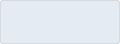 | `--primary-fill` | `#e4ebf2` | Selected row |
| 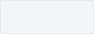 | `--primary-highlight` | `#f3f6f9` | Hovered row |

### Light blue (info)

Used for help text, notices and a toggle that is on.

| | Token | Hex | Used for |
|---|---|---|---|
|  | `--info-strong` | `#345d7b` | Text in light blue, filled buttons |
|  | `--info` | `#a6d3f5` | A toggle that is on |
|  | `--info-border` | `#5f89a9` | Borders, the outline of a toggle that is on, chart marks |
| 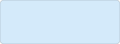 | `--info-fill` | `#d4eafa` | Background for help text and notices |
| 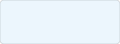 | `--info-highlight` | `#ecf6fd` | Hover |

### Orange (secondary)

Used for an in-progress state, such as the rows a drag is currently selecting, and for warnings.

| | Token | Hex | Used for |
|---|---|---|---|
| 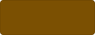 | `--secondary-strong` | `#7b5002` | Text in orange, filled buttons |
|  | `--secondary`, `--warning` | `#e89a0c` | Warnings |
| 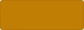 | `--secondary-border`, `--state-active-solid` | `#c07e04` | The edge of an active row, chart marks |
| 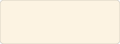 | `--secondary-fill` | `#fcf3e2` | Active background |
| 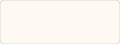 | `--secondary-highlight` | `#fefaf2` | Hover |

### Green (success)

| | Token | Hex | Used for |
|---|---|---|---|
|  | `--success-strong` | `#036737` | Text in green, filled buttons |
|  | `--success` | `#0f9d58` | Success icons |
|  | `--success-border` | `#0f9d58` | Borders, chart marks |
| 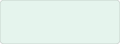 | `--success-fill` | `#e5f4ed` | Success background |
| 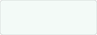 | `--success-highlight` | `#f3faf7` | Hover |

### Red (danger)

| | Token | Hex | Used for |
|---|---|---|---|
|  | `--danger-strong` | `#963221` | Pressed danger button, text in red |
|  | `--danger` | `#c0402a` | Errors, danger buttons |
|  | `--danger-border` | `#e25f48` | Borders, chart marks |
| 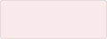 | `--danger-fill` | `#f8eae8` | Error background |
|  | `--danger-highlight` | `#fcf6f4` | Hover |

### Purple (category)

Purple has no fixed meaning, so it is used to tell categories apart where the other colours already carry one.

| | Token | Hex | Used for |
|---|---|---|---|
|  | `--category-strong` | `#4a016b` | Pressed, text in purple |
| 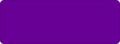 | `--category` | `#690096` | Categories, filled buttons |
|  | `--category-border` | `#b562e9` | Borders, chart marks |
| 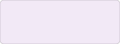 | `--category-fill` | `#f2e9f6` | Category background |
|  | `--category-highlight` | `#f9f5fb` | Hover |

### Grey

The greys are one scale, from text down to surfaces.

| | Token | Hex | Used for |
|---|---|---|---|
|  | `--text` | `#333333` | Text |
|  | `--text-muted`, `--control-off-edge` | `#666666` | Muted text, the outline of a toggle that is off |
|  | `--text-faint` | `#717171` | Faint text |
|  | `--border-strong`, `--field-border`, `--control-off` | `#8f8f8f` | Field borders, a toggle that is off |
|  | `--border`, `--text-disabled` | `#cccccc` | Dividers, disabled text |
| 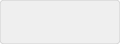 | `--border-subtle` | `#efefef` | Subtle dividers |
| 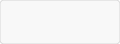 | `--surface-sunken` | `#f8f8f8` | Recessed backgrounds |
| 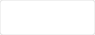 | `--surface` | `#ffffff` | Backgrounds |

## States

| State | Tokens | Meaning |
|---|---|---|
| Hover | `--state-hover` | The pointer is over the element |
| Selected | `--state-selected`, `--state-selected-solid` | The element has been chosen, e.g. a checked option in a dropdown |
| Active | `--state-active`, `--state-active-solid` | The element is in a temporary state that changes when the action finishes, e.g. rows a drag is passing over |

Buttons do not have a selected state. On hover, a button's border and label change
colour and its background stays the same.

## Accessibility

Every pairing in this document meets [WCAG 2.2](https://www.w3.org/TR/WCAG22/) level AA:
4.5:1 for text and 3:1 for borders, icons and chart marks. New tokens should meet it
too.

- Colour should never be the only way a state is shown. A selected or active row
  should also have a bar on its left edge, a checkbox should show a tick, and a
  toggle should move its handle.
- Two states should differ in lightness, not only in hue, so they can be told apart
  by someone who cannot distinguish the colours.
- Text in a colour should use its `-strong` shade. The light blue, orange and green
  bases are too light for text, and too light for white text on top of them, so a
  filled button in one of those colours should use `-strong` as its background.
- `--text-faint` meets 4.5:1 on `--surface` and `--surface-sunken` only. On a
  coloured `-fill`, use `--text` or `--text-muted`.
- A field or control should have a border that meets 3:1 against white
  (`--field-border`, a `-border` shade). `--border` and `--border-subtle` are for
  dividers, which do not need to.
- A control drawn in a light colour should have an outline so it is visible against
  a white page (`--info-border`, `--control-off-edge`). Use an `inset` box-shadow for
  the outline so the control does not change size when its state changes.

If a token's value does not meet these rules, the value should be changed in
`tokens.css` so the fix applies everywhere.

## Fonts

| Token | Font | Used for |
|---|---|---|
| `--font-family` | The operating system's default interface font | All text |
| `--font-family-mono` | The operating system's default monospace font | Identifiers |

The monospace font should be used for values someone might copy or type out:
PSCIDs, DCCIDs, visit labels, barcodes, file names and paths. It should not be used
for field names, counts or sentences.

## Where styles go

| What | Where |
|---|---|
| Values shared by more than one component | `htdocs/css/tokens.css` |
| A component's own styling | A CSS file next to the component, imported by it |
| A module's own layout | `modules/<module>/css/`, imported by the module's JSX |
| Anything with a `:hover`, `:focus` or `:disabled` state | A CSS file, not an inline style |

Inline styles cannot express states or media queries, so they should only be used
for values calculated at runtime.

## Bootstrap

LORIS uses Bootstrap 3, which stopped receiving security updates in 2019. Removing it
would affect every module, so it remains for now, but new components should not
depend on it and should take their styling from the tokens instead.

Reusing a Bootstrap class with a different layout leads to specificity conflicts.
For example, `.form-control` sets `display: block`, `.input-group` sets
`display: table` and `.list-group-item.active` sets `z-index: 2`, and each can
override a rule of equal specificity depending on load order. Qualify the selector with
the element (e.g. `button.my-trigger`) instead of using `!important`.
