# Design System

## Overview

This document describes the design tokens used to style LORIS and the conventions
for using them. The tokens are defined in [`htdocs/css/tokens.css`](../../../htdocs/css/tokens.css),
which is loaded on every page. For language conventions, see
[CodingStandards.md](../../CodingStandards.md).

## Tokens

Colours, spacing and border radii should come from `tokens.css` rather than being
hardcoded. If no existing token fits, a new one should be added to `tokens.css`.
Visualizations take their colours from the same hues, such as the electrode and
sensor colours in the electrophysiology browser, so a chart reads the same in every
module. A visualization that needs a colour the hues do not have, even a slight
variation, gets it added to the palette so other modules can use it too.

```css
/* Avoid */
.thing { background: #eaf1f8; border-radius: 4px; padding: 8px; }

/* Prefer */
.thing {
    background: var(--primary-fill);
    border-radius: var(--radius);
    padding: var(--space-md);
}
```

Tokens are named for what they are used for (`--primary`, `--border`, `--text-muted`)
rather than for their value, so changing a token's value restyles everything that
uses it.

## Colours

Colour comes in two layers. The scales are the palette: the brand, two notice
colours (amber for warnings, sky for information), nine hues and grey, each with
five numbered steps. The roles say what a colour means (`--primary`, `--danger`,
`--state-selected`) and each one points at a step.
Components use the roles. A colour that means a state, such as an error or a
selected row, uses a role; a colour that only tells categories apart, such as one
tag per project, uses a hue directly.

Visualizations take their colours from the same hues, such as the electrode and
sensor colours in the electrophysiology browser, so a chart reads the same in every
module. A visualization that needs a colour the hues do not have, even a slight
variation, gets it added to the palette so other modules can use it too.

### Steps

Every scale runs from light to dark. Each step has one job in every scale, and the
contrast that job needs:

| Step | Used for | Contrast |
|---|---|---|
| 1 | Backgrounds: a notice, a tag | `--text` on it is at least 4.5:1 |
| 2 | Row states: a selected, active or open row | `--text` and the scale's step 5 on it are at least 4.5:1, and it shows against white |
| 3 | Decoration: tag outlines, decorative borders, chart marks on a dark background | None, so a light hue shows here at its brightest |
| 4 | Anything that must be seen on white: icons, filled buttons, navigation, field borders, chart marks on a light background | At least 3:1 against white and against step 1 |
| 5 | Text in that colour, pressed states | At least 6:1 against white, and 4.5:1 against steps 1 and 2 |

To pick a step, find what is being drawn and where:

| Drawing | On | Step |
|---|---|---|
| A tag | Any surface | 1 background, 3 outline, 5 text |
| A notice | Any surface | 1 background, 4 border, 5 heading |
| A row in a state | The table | 2 background, 4 bar on its left edge |
| A chart mark, line or bar | White or a light surface | 4, or 5 for a second series in the same hue |
| A chart mark, line or bar | A dark surface | 3 |
| An icon or a field border | White or a light surface | 4 |
| Text | White or steps 1 and 2 | 5 |

WCAG asks for 3:1 only where colour is needed to understand something, such as a
chart series told apart by colour or the edge of a field. A tag's outline is
decoration, since its label carries the meaning, so step 3 has no contrast duty.

The roles keep the same suffixes in every colour: none and `-border` for step 4,
`-strong` for step 5 and `-fill` for step 1. Hover uses grey step 1 and the other
state tokens use step 2.

| Role | Scale |
|---|---|
| `--primary` | Brand |
| `--info` | Sky |
| `--warning` | Amber |
| `--success` | Green |
| `--danger` | Red |
| `--category` | Purple |
| `--text`, `--border`, `--border-strong`, `--border-subtle`, `--surface-sunken` | Grey |

LORIS's brand navy comes from the "Loris color palette v.0.1" in the header of
`htdocs/bootstrap/css/custom-css.css`, and so does amber, its orange. Amber and sky
are kept for warnings and information, so a notice never looks like a category; the
hues include a separate, redder orange and a teal set apart from sky. The greys are
LORIS's existing grey scale.

Each hue is a chosen colour and, for its darker steps, an angle and a limit on how
vivid they get, all worked out in OKLCH. Step 4 is the chosen colour when it reaches
3:1 against white. A lighter colour (amber, orange, yellow, teal, sky) takes the
lightest shade of itself that does, and keeps its own bright colour as step 3; in
every other hue, step 3 sits halfway between step 2 and step 4. Step 5 is the
lightest shade that reaches 6:1. Step 1 is a faint tint at one lightness for every
hue and step 2 a stronger tint. Warm hues lean towards red in their darker
steps and towards yellow in their tints, since they turn muddy at their own angle.
The hues are chosen so that no two are close at steps 4 and 5, checked with normal
vision and with the three common kinds of colour blindness. Nine hues is near the
limit that stays apart, so a chart should not need all of them, and a tag always
carries its label.

A colour that is not in these tables should be added here and to `tokens.css`
before it is used, with every pairing checked against the rules under
Accessibility.

### Brand

Actions, navigation and panel headings. LORIS's brand is navy.

| | Token | Hex | Contrast on white | Role |
|---|---|---|---|---|
|  | `--brand-1` | `#fafcfe` | 1.03:1 | `--primary-fill` |
| 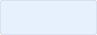 | `--brand-2` | `#e7f1fe` | 1.14:1 | `--state-selected` |
|  | `--brand-3` | `#9dbee8` | 1.92:1 |  |
|  | `--brand-4` | `#064785` | 9.34:1 | `--primary`, `--primary-border` |
|  | `--brand-5` | `#01376b` | 11.93:1 | `--primary-strong` |

### Amber

Warnings, and only warnings. Amber is LORIS's orange, so no category uses it.

| | Token | Hex | Contrast on white | Role |
|---|---|---|---|---|
|  | `--amber-1` | `#fffcf1` | 1.03:1 | `--warning-fill` |
|  | `--amber-2` | `#fdf4d2` | 1.10:1 | `--state-active` |
|  | `--amber-3` | `#e89a0c` | 2.32:1 |  |
|  | `--amber-4` | `#cb7602` | 3.42:1 | `--warning`, `--warning-border` |
| 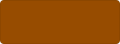 | `--amber-5` | `#974c00` | 6.27:1 | `--warning-strong` |

### Sky

Information, and only information: help, notices, an open row and a toggle that is
on. No category uses it.

| | Token | Hex | Contrast on white | Role |
|---|---|---|---|---|
|  | `--sky-1` | `#f6fdff` | 1.03:1 | `--info-fill` |
|  | `--sky-2` | `#daf6fc` | 1.13:1 | `--state-open` |
|  | `--sky-3` | `#75dcf0` | 1.58:1 |  |
|  | `--sky-4` | `#0396c6` | 3.40:1 | `--info`, `--info-border` |
|  | `--sky-5` | `#02688b` | 6.26:1 | `--info-strong` |

### Red

Errors and danger buttons.

| | Token | Hex | Contrast on white | Role |
|---|---|---|---|---|
| 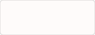 | `--red-1` | `#fefbfa` | 1.03:1 | `--danger-fill` |
|  | `--red-2` | `#ffebe8` | 1.15:1 |  |
| 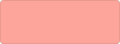 | `--red-3` | `#fda59a` | 1.90:1 |  |
|  | `--red-4` | `#cc1e1e` | 5.57:1 | `--danger`, `--danger-border` |
|  | `--red-5` | `#a92420` | 7.09:1 | `--danger-strong` |

### Orange

| | Token | Hex | Contrast on white | Role |
|---|---|---|---|---|
|  | `--orange-1` | `#fefbf8` | 1.03:1 |  |
|  | `--orange-2` | `#fff0e6` | 1.11:1 |  |
|  | `--orange-3` | `#f1840b` | 2.61:1 |  |
|  | `--orange-4` | `#de6907` | 3.43:1 |  |
|  | `--orange-5` | `#9e4801` | 6.21:1 |  |

### Brown

| | Token | Hex | Contrast on white | Role |
|---|---|---|---|---|
| 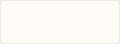 | `--brown-1` | `#fffbf6` | 1.03:1 |  |
| 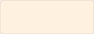 | `--brown-2` | `#fff1e0` | 1.11:1 |  |
| 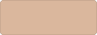 | `--brown-3` | `#dab79d` | 1.87:1 |  |
| 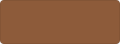 | `--brown-4` | `#8d5b3a` | 5.69:1 |  |
| 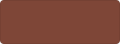 | `--brown-5` | `#7e4637` | 7.45:1 |  |

### Yellow

| | Token | Hex | Contrast on white | Role |
|---|---|---|---|---|
|  | `--yellow-1` | `#fffbf4` | 1.03:1 |  |
| 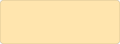 | `--yellow-2` | `#ffe5ae` | 1.23:1 |  |
|  | `--yellow-3` | `#eab526` | 1.89:1 |  |
| 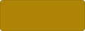 | `--yellow-4` | `#ad8405` | 3.45:1 |  |
| 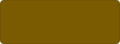 | `--yellow-5` | `#7a5b01` | 6.32:1 |  |

### Green

Success.

| | Token | Hex | Contrast on white | Role |
|---|---|---|---|---|
|  | `--green-1` | `#f4fff9` | 1.02:1 | `--success-fill` |
| 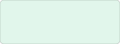 | `--green-2` | `#e1f6eb` | 1.13:1 |  |
|  | `--green-3` | `#8bc9ac` | 1.90:1 |  |
|  | `--green-4` | `#059669` | 3.77:1 | `--success`, `--success-border` |
|  | `--green-5` | `#006e4c` | 6.30:1 | `--success-strong` |

### Teal

| | Token | Hex | Contrast on white | Role |
|---|---|---|---|---|
|  | `--teal-1` | `#f5feff` | 1.02:1 |  |
|  | `--teal-2` | `#cefaff` | 1.12:1 |  |
|  | `--teal-3` | `#3bcddc` | 1.92:1 |  |
|  | `--teal-4` | `#059aa6` | 3.40:1 |  |
|  | `--teal-5` | `#036c75` | 6.17:1 |  |

### Blue

| | Token | Hex | Contrast on white | Role |
|---|---|---|---|---|
| 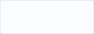 | `--blue-1` | `#fafcff` | 1.03:1 |  |
| 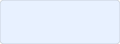 | `--blue-2` | `#e8f1ff` | 1.14:1 |  |
|  | `--blue-3` | `#9bbef4` | 1.90:1 |  |
|  | `--blue-4` | `#1f5fc8` | 5.95:1 |  |
|  | `--blue-5` | `#1251a6` | 7.63:1 |  |

### Purple

Telling categories apart where the other colours already carry a meaning.

| | Token | Hex | Contrast on white | Role |
|---|---|---|---|---|
| 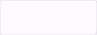 | `--purple-1` | `#fdfbff` | 1.03:1 | `--category-fill` |
|  | `--purple-2` | `#f6ebfd` | 1.15:1 |  |
|  | `--purple-3` | `#d7abf1` | 1.91:1 |  |
|  | `--purple-4` | `#9137bb` | 6.06:1 | `--category`, `--category-border` |
|  | `--purple-5` | `#79329b` | 7.66:1 | `--category-strong` |

### Pink

| | Token | Hex | Contrast on white | Role |
|---|---|---|---|---|
|  | `--pink-1` | `#fffafb` | 1.03:1 |  |
| 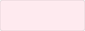 | `--pink-2` | `#feeaef` | 1.15:1 |  |
|  | `--pink-3` | `#f9a3bc` | 1.91:1 |  |
|  | `--pink-4` | `#db2777` | 4.60:1 |  |
|  | `--pink-5` | `#ae2d61` | 6.27:1 |  |

### Grey

| | Token | Hex | Contrast on white | Role |
|---|---|---|---|---|
|  | `--grey-1` | `#f8f8f8` | 1.06:1 | `--surface-sunken`, `--state-hover` |
| 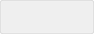 | `--grey-2` | `#efefef` | 1.15:1 | `--border-subtle` |
|  | `--grey-3` | `#cccccc` | 1.61:1 | `--border`, `--text-disabled` |
|  | `--grey-4` | `#8f8f8f` | 3.23:1 | `--border-strong`, `--field-border`, `--control-off` |
|  | `--grey-5` | `#333333` | 12.63:1 | `--text` |

Three grey roles sit between the steps:

| | Token | Hex | Used for |
|---|---|---|---|
|  | `--text-muted`, `--control-off-edge` | `#666666` | Muted text, the outline of a toggle that is off |
|  | `--text-faint` | `#717171` | Faint text |
| 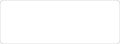 | `--surface` | `#ffffff` | Backgrounds |

## States

| State | Tokens | Meaning |
|---|---|---|
| Hover | `--state-hover` | The pointer is over the element |
| Selected | `--state-selected`, `--state-selected-solid` | The element has been chosen, e.g. a checked option in a dropdown |
| Open | `--state-open`, `--state-open-solid` | The record shown in a side panel, in the info family |
| Active | `--state-active`, `--state-active-solid` | The element is waiting for an action, or in a temporary state that ends when the action finishes, e.g. rows ticked for a batch action, rows a drag is passing over |

Hover is grey step 1 and the other states are step 2 tints, so a hovered,
selected, active or open row shows against white. The `-solid` tokens are for the
bar on the row's left edge.

In a table, the row shown in the record panel is open, in the info colour, with a bar
in `--state-open-solid` on its left edge. A row whose checkbox is ticked is active, in
orange: it waits for the action the selection will take. A row that is both stays
orange, and the bar shows it is open.

Buttons do not have a selected state. On hover, a primary or secondary button's border
and label change colour. A quiet button, drawn as text, takes `--state-hover` behind
its label; an underline marks a link, not an action.

## Elevation

| Token | Used for |
|---|---|
| `--shadow-raised` | A small control lifted off its surface, such as a row's menu |
| `--shadow-overlay` | A floating panel, such as a dropdown or a dialog |
| `--shadow-side` | A panel that slides over the rows from the right, casting its shadow to the left only |

The data sits on the bottom layer. Headers, footers and toolbars that stay in place
above it are flat, divided from it by a border rather than a shadow, so the data never
sits under a heavy edge. Only what lies over the data casts a shadow, and only onto
the data.


## Page chrome

The navbar is the darker navy, `--primary-strong`, so a filled primary button
stands apart from the bar above it. A hovered or open menu item turns white and
joins the menu that opens below it.

| Token | Draws from | Used for |
|---|---|---|
| `--chrome-bg` | `--primary-strong` | The navbar's background |
| `--chrome-text` | `--surface` | Its links and icons |
| `--chrome-hover` | `--surface` | A hovered or open menu item |
| `--chrome-hover-text` | `--primary-strong` | That item's text |

## Motion

| Token | Value | Used for |
|---|---|---|
| `--duration-fast` | 120ms | A small change in place: a caret turning, a label rising, a toggle's handle |
| `--duration-base` | 200ms | A short move or a small change of size: a column's width |
| `--duration-slow` | 300ms | A move across much of the screen: the filters, a side panel |
| `--ease` | `cubic-bezier(.4, 0, .2, 1)` | Every animation: it eases in and out, so nothing starts or stops abruptly |

Everything moves on the one curve, and the duration follows the distance: the further
something travels, the longer it takes. A change in size or position animates, so the
eye can follow what moved: a column eases to its new width, the filters grow from the
edge and push the rows aside, and a side panel slides in and back out from its edge.
Opening and closing move the same way. Text changes do not animate, apart from a
field's label as it rises. A colour change on hover may fade in over the fast duration,
so the hovered element doesn't flicker; a change of state (selected, open, active)
appears at once. Under `prefers-reduced-motion: reduce` every
transition and animation is turned off, and changes happen at once.

## Accessibility

Every pairing in this document meets [WCAG 2.2](https://www.w3.org/TR/WCAG22/) level AA:
4.5:1 for text and 3:1 for borders, icons and chart marks. New tokens should meet it
too. Disabled text (`--text-disabled`) is the one exception, as WCAG allows for
inactive controls. A disabled control should say why it is disabled on hover, using
`aria-disabled` rather than `disabled`, which blocks hover in some browsers.

- Colour should never be the only way a state is shown. A selected or active row
  should also have a bar on its left edge, a checkbox should show a tick, and a
  toggle should move its handle.
- Two states should differ in lightness, not only in hue, so they can be told apart
  by someone who cannot distinguish the colours.
- Text in a colour should use its step 5 (`-strong`). White text reaches 4.5:1 on
  step 4 of the brand, red, brown, blue, purple and pink; a filled button in any
  other colour uses step 5 as its background.
- Chart marks on a light background and the borders of fields use step 4 or step 5;
  chart marks on a dark background use step 3.
- `--text-faint` meets 4.5:1 on `--surface` and `--surface-sunken` only. On a
  coloured tint, use `--text` or `--text-muted`.
- A field or control should have a border that meets 3:1 against white
  (`--field-border`, a step 4). `--border` and `--border-subtle` are for
  dividers, which do not need to.
- A control drawn in a light colour should have an outline so it is visible against
  a white page (`--info-border`, `--control-off-edge`). Use an `inset` box-shadow for
  the outline so the control does not change size when its state changes.

If a token's value does not meet these rules, the value should be changed in
`tokens.css` so the fix applies everywhere.

## Components

New React components take their colours, spacing and states from the tokens and
live at the top of `jsx/`, so any module can use them.

### Icon

`jsx/Icon.tsx` draws an icon from [Lucide](https://lucide.dev) by name, as tall as
the text around it and in its colour: `<Icon name="search" />`. The icon is hidden
from assistive technology, so the control it sits in needs its own label: visible
text, or an `aria-label` with a Tooltip. New icons are added to its list of names.
Font Awesome remains for the page templates.

### Tag

`jsx/Tag.tsx` labels a value from a fixed set, such as a status or a category:
`<Tag tone="success">Closed</Tag>`. A tone is a role, `neutral` (the default), `primary`,
`info`, `success`, `warning` or `danger`, or a hue such as `teal` or `purple`. Each tag
uses its scale's step 1 for its background, step 3 for its outline and step 5 for its
text. The label always says what the colour means.

A value is a tag when it is an option from a short, fixed set that the reader scans a
column for: a status, a category, a flag. A value that names another record, such as a
site, a project or a cohort, shows its name after a small icon of its kind, and several
in one cell are set apart by a space. Identifiers, dates, numbers and free text are
plain text. A value shows the same way in a table and in its filter.

A tag takes a colour when its value is a state someone acts on: `success` for a good or
finished state, `warning` for one that needs attention, `danger` for a problem, `info`
for a state worth noticing. A category with no state is a neutral tag. When a category
has two or three values worth telling apart at a glance, such as entity type, each takes
a hue, such as `blue` or `teal`, never a role. Sex stays neutral, since a colour per sex
reads as a stereotype.

A yes-or-no value shows as a check for yes and stays empty for no in a table, where the
column gives the empty cell its meaning. The record panel writes out Yes and No. In a
RecordTable this is a column of `type: 'yes-no'`.

In a RecordTable, a column shows its values as tags with `tag: true`, or with a map
from value to tone, such as `tag: {'1': 'danger', '3': 'success'}`, where a value the
map leaves out is neutral. A column of linked records names its kind's icon with
`relation`, such as `relation: 'place'`. A row shows the tags or names that fit, with a
count for the rest; the record panel shows them all.

A cell that opens a page is one link across the cell, outlined with an arrow on hover:
`link: (value, record) => url`. A value links only when it has a page to open.

### Tooltip

`jsx/Tooltip.tsx` names or explains the element it wraps, on hover and on keyboard
focus. Icon-only buttons use it for their name, and table cells use it to show a value
their column cuts short.

### Field list

`jsx/FieldList.tsx` shows label and value pairs, one pair per row, as on a
record's card or in the record panel. Labels are in `--text-muted` and values in
`--text`.

```tsx
import FieldList from 'jsx/FieldList';

<FieldList
  size="sm"
  fields={[
    {name: 'site', label: t('Site'), value: site},
    {name: 'cohort', label: t('Cohort'), value: <Tag>{cohort}</Tag>},
  ]}
/>
```

| Prop | Values | Effect |
|---|---|---|
| `fields` | `{name, label, value, wide}[]` | The rows, in order; `name` is the React key, and `wide` gives a pair the full width in the `grid` layout |
| `layout` | `inline` (default), `inline-end`, `stacked`, `grid` | `inline` puts labels in one column and values in the next; `inline-end` aligns those labels against their values; `stacked` puts each label above its value; `grid` sets label-above-value pairs in as many columns of at least 150px as fit |
| `size` | `md` (default), `sm` | `sm` sets `--font-size-sm` and tighter rows, for cards |

In the inline layouts, the label column fits the longest label, up to 40% of the list's width. Lists
that sit side by side, such as a grid of cards, set `--field-list-label-width`
on a shared ancestor (the cards use `10em`), so every value starts at the same
offset in every list.

Every row is at least a tag's height, so a row of text and a row of tags are the
same height. Long values and several tags wrap inside the value column, and the
label stays on the value's first line. An empty value (`null`, `undefined`,
`false`, `''` or `[]`) shows a dash; `0` is a value and shows as `0`.

`FieldSections`, from the same file, sets several field lists under headings, each
one folding away from its heading. A section without a `label` has no heading and
stays open. A folded section stays folded from one record to the next.

```tsx
import {FieldSections} from 'jsx/FieldList';

<FieldSections
  sections={[
    {name: 'participant', label: t('Participant'), fields: participantFields},
    {name: 'visits', label: t('Visits'), fields: visitFields, collapsed: true},
  ]}
/>
```

Lists that follow one another, as in sections, share their label column through
`--field-list-label-width` (the record panel uses `min(40%, 12em)`), so values
start on the same line all the way down.

### Table names

A page with several tables names each one on its title line, above the views. The table
shown is in full colour and underlined in the text colour, the others are paler, and a
thin rule runs under the line, so the names read as tabs one level above the views. A
page with one table shows its name alone, with no rule.

### Record panel

Clicking a row in a RecordTable opens its record in a panel on the right. The
panel's head holds the record's name, its actions and the controls that move
between records and close the panel. The first action is a secondary button
beside the name and any others are in the ⋯ menu next to it, as Ant Design's
Descriptions puts its actions at the top right of its title and Salesforce and
Jira put a record's actions on its name's line.

A table says how its records read with `recordLayout`, naming its columns:

```js
recordLayout={{
  title: 'pscid',
  key: ['dccid', 'participantStatus', {name: 'site', wide: true}],
  sections: [
    {label: t('Participant'), fields: ['sex', 'DoB', 'project']},
    {label: t('Visits'), fields: ['visitLabel', 'visitCount'], collapsed: true},
  ],
}}
```

| Key | Effect |
|---|---|
| `title` | The column whose value names the record in the panel's head; the first column otherwise |
| `key` | The fields that matter most, in a band under the head; `{name, wide: true}` gives one the band's full width |
| `sections` | Groups of fields under headings that fold, in order |

The key fields read as the record's summary, as in Salesforce's highlights panel:
label-above-value pairs, two to a row, on `--surface-sunken` between two faint
rules. A field with long values, such as a site's name or a list of tags, is marked
wide and takes a row to itself, so the band keeps the same shape from one record to
the next. The sections below set
one label and value a row, with labels in one column all the way down.

Every column the layout leaves out follows in a last section, More fields, in
column order, so a new column always shows somewhere. A table without a
`recordLayout` shows every column after the title in column order, with no
headings. Hidden columns show in the panel too.

### Select menus

A dropdown is as wide as its options need, at least 180px and never narrower than its
field. Its options run edge to edge, each highlighted with a square fill; the chosen
option takes `--state-selected` with the selected bar on the menu's left border. A list of eight options
or fewer has no search box. In a multiple choice, the line at the foot counts what is
selected and holds Select all and Deselect all as text actions.

## Fonts

| Token | Font | Used for |
|---|---|---|
| `--font-family` | The operating system's default interface font | All text |
| `--font-family-mono` | The operating system's default monospace font | Identifiers |

| Token | Size | Used for |
|---|---|---|
| `--font-size-lg` | 18px | Titles: a table's name, the record in a side panel |
| `--font-size` | 14px | Body text |
| `--font-size-sm` | 12px | Labels, counts and notes |
| `--font-size-xs` | 11px | Raised field labels |

The monospace font should be used for values someone might copy or type out:
PSCIDs, DCCIDs, visit labels, barcodes, file names and paths. It should not be used
for field names, counts or sentences.

Dates and numbers are set in the body font with tabular figures, so their digits line
up down a column, and numbers align right.

## Where styles go

| What | Where |
|---|---|
| Values shared by more than one component | `htdocs/css/tokens.css` |
| A component's own styling | A CSS file next to the component, imported by it |
| A module's own layout | `modules/<module>/css/`, imported by the module's JSX |
| Anything with a `:hover`, `:focus` or `:disabled` state | A CSS file, not an inline style |

Inline styles cannot express states or media queries, so they should only be used
for values calculated at runtime.

## Bootstrap

LORIS uses Bootstrap 3, which stopped receiving security updates in 2019. Removing it
would affect every module, so it remains for now, but new components should not
depend on it and should take their styling from the tokens instead.

Reusing a Bootstrap class with a different layout leads to specificity conflicts.
For example, `.form-control` sets `display: block`, `.input-group` sets
`display: table` and `.list-group-item.active` sets `z-index: 2`, and each can
override a rule of equal specificity depending on load order. Qualify the selector with
the element (e.g. `button.my-trigger`) instead of using `!important`.
